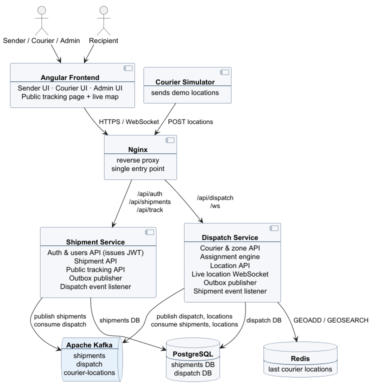

# Architecture

The system consists of an Angular frontend, two Spring Boot services, a courier simulator and shared infrastructure: Apache Kafka, PostgreSQL and Redis.

**Nginx** is the single entry point. It serves the frontend and routes API requests by path: authentication, shipments and public tracking go to the **Shipment Service**, while couriers, zones, locations and the live map WebSocket go to the **Dispatch Service**. Because everything is served from one origin, the frontend needs no CORS configuration and does not depend on how many services exist behind the proxy.

The services never call each other directly. Each one publishes events through a **Transactional Outbox** and consumes the other service's events from Kafka. The Shipment Service issues JWT tokens at login, and the Dispatch Service only validates them with the shared signing key, so it never needs to ask the Shipment Service who the user is.

Courier locations follow a separate path. The courier app (or the simulator in the demo) sends a location every few seconds to the Location API, which publishes it to the `courier-locations` topic. A consumer stores the latest position of every courier in Redis and pushes it over WebSocket to recipients whose shipment is out for delivery. The Assignment Engine queries Redis to find couriers when assigning new shipments.