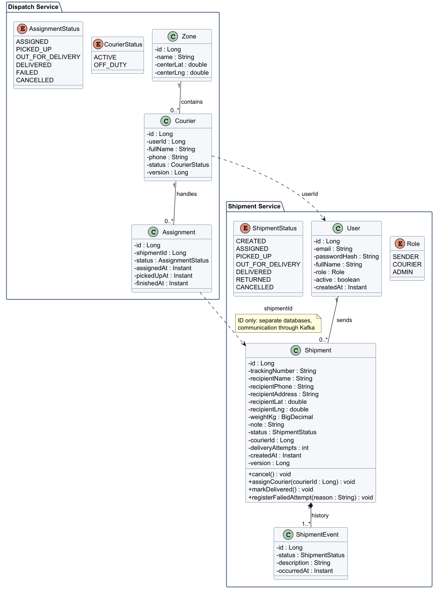

# Class Diagram

The system is split into two services, each with its own database. The **Shipment Service** owns users, shipments and the shipment history. A sender creates many shipments, and every status change of a shipment is stored as a new `ShipmentEvent`, so the history is never overwritten. Business rules such as cancelling, assigning a courier and counting failed delivery attempts live in the `Shipment` class itself.

The **Dispatch Service** owns delivery zones, couriers and assignments. Each courier belongs to one zone and handles many assignments over time. Classes in different services reference each other only by ID (`userId`, `shipmentId`), because the services never share a database and exchange data through Kafka events.
