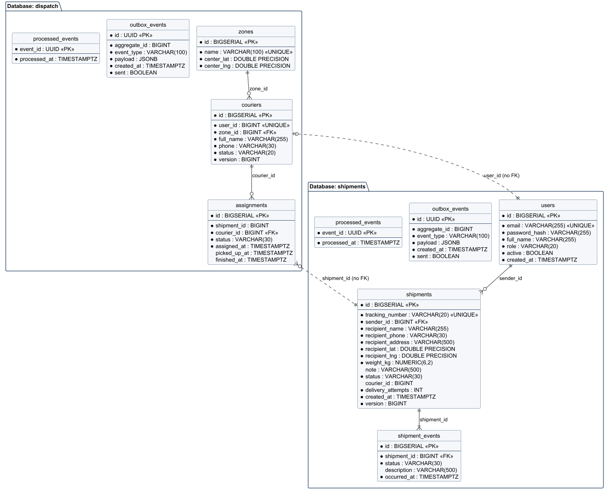

# Database

The system uses one PostgreSQL server with two separate databases, `shipments` and `dispatch`. Each service connects with its own database user and can access only its own database, so services never read each other's tables. References between the databases (`assignments.shipment_id`, `couriers.user_id`) are plain columns without foreign key constraints; consistency between them is kept through Kafka events.

The shipment history is append-only: every status change inserts a new row into `shipment_events` and existing rows are never updated. The `version` columns enable optimistic locking, so two concurrent updates of the same shipment or courier cannot overwrite each other.

Both databases contain two technical tables. `outbox_events` stores events in the same transaction as the business change, and a separate process publishes them to Kafka (Transactional Outbox pattern). `processed_events` stores the IDs of events a service has already handled, so a message delivered twice is processed only once.

The schema is created and versioned with Flyway migrations.
