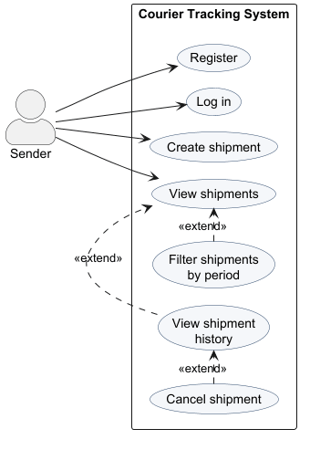
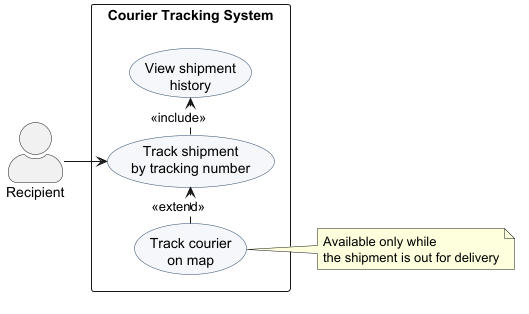
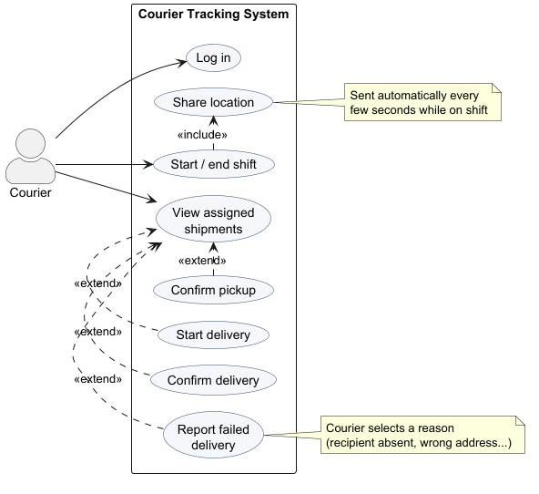
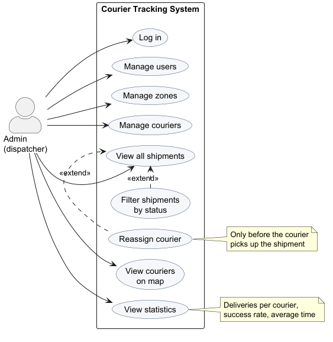

# Use Cases

The system has four actors: **Sender**, **Recipient**, **Courier** and **Admin (dispatcher)**. The recipient is the only actor without an account.

## Sender

The sender registers and logs in to the system; all other features are available only after logging in. The sender creates shipments and views the list of their shipments, which can be filtered by period. For each shipment the sender can view its history and, until a courier picks it up, cancel it.

## Recipient

The recipient does not have an account. They track a shipment by entering its tracking number, which shows the complete shipment history with the time of every status change. While the shipment is out for delivery, the recipient can also follow the courier's location on a live map.

## Courier

The courier logs in and starts a shift, after which the application automatically shares the courier's location every few seconds. The courier views the list of shipments assigned to them and, depending on each shipment's status, confirms pickup, starts the delivery, and confirms a successful delivery or reports a failed one with a reason.

## Admin (dispatcher)

The admin acts as the dispatcher of the system. After logging in, the admin manages users, delivery zones and couriers, and oversees all shipments, which can be filtered by status. Before a shipment is picked up, the admin can reassign it to a different courier. The admin can also see all active couriers on a live map and view delivery statistics.